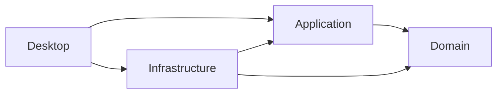
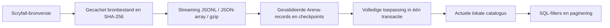
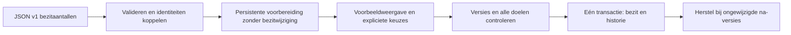

# Architectuur

## Actueel — v1.3.0, fase 16

De actieve desktop bevat uitsluitend de fysieke werkruimte, deckwizard en instellingen.
De oude Arena-viewmodels/views staan onder Application.Tests/Legacy, inclusief een
LegacyShell/LegacyWindow voor regressies. Zij zitten niet in de desktopassembly.
Historische domein-/opslagmodellen en migraties blijven voor gegevensbehoud/herstel.
Onderstaande oudere fasebeschrijvingen zijn historisch waar zij Arena-navigatie noemen.

CardThemes combineert collectiefilters op ondersteunde rollen. SynergyProfiles bewaakt 87 gecontroleerde Oracle-profielen met een gameplayvingerafdruk. SynergyTextRules levert beperkte feiten en bewijsclausules voor overige kaarten. SynergyEngine bouwt voorwaardelijke relaties, conflicten en ontbrekende ondersteuning; SynergySelection gebruikt de gekozen kaarten als context. SynergyReplacement onderscheidt thematische overeenkomst van functionele gelijkwaardigheid. DeckManaHeuristics telt kosten, niet manaoutput. Alle logica staat in Application; geen UI- of opslagafhankelijkheid. Geen nieuwe migratie: optionele power/toughness wordt uit opgeslagen Scryfall-JSON gelezen. Meerdere kaartkanten en herkende eigen verliesvoorwaarden worden niet automatisch geselecteerd.
PaperCard houdt geprinte kleuren apart van kleuridentiteit; Scryfall set_name/kleuren
worden uit reeds opgeslagen metadata gelezen, zonder extra kaartkolommen.

DeckWizardViewModel beheert vijf schermstappen. DeckWizardRequest valideert keuzes in
Application. SqlitePaperWorkspace bereidt een tijdelijk PaperDeckDraft voor; de bestaande
planners handhaven Oracle-limieten, exacte voorraad, formaat, actualiteit en identiteit.
Planning kan via IPaperCatalog een begrensde pool ophalen; elke kaart wordt lokaal
opnieuw op fysieke uitgave, kleuridentiteit en legaliteit gecontroleerd.
Thema/stijl veranderen rangschikking, niet voorraad of harde regels. Opslag hercontroleert
voorraad-/metadata-afdruk en bronverval en maakt idempotent een nieuw deck.

IDatabaseResetService maakt een snapshotpreview met SHA-256 over alle twintig modeltabellen.
Clear vereist dezelfde preview en exact WISSEN, blokkeert gepland herstel, vergrendelt
schrijvers en maakt eerst een consistente gecontroleerde SQLite-reservekopie. Een tweede
afdrukcontrole binnen de delete-transactie bewaakt externe wijzigingen. Tabellen worden
in FK-volgorde geleegd; daarna resteert alleen een standaard Settings-rij met voorbeelden
uit. Migratie negen voegt ExamplesEnabled toe, standaard true. Schema, migraties, back-ups,
logs en afbeeldingen blijven behouden. Geen databaseverwijdering of EnsureCreated.

Desktop-assets gebruiken het aangeleverde WebP-logo, een PNG voor Avalonia en ICO met
meerdere resoluties voor Windows. Het kleine icoon is het herkenbare symbool uit hetzelfde
logo. De formatconversie is reproduceerbaar met scripts/BrandAssets.

## Afhankelijkheden

Desktop bevat het composition root. Domain heeft geen pakketafhankelijkheden.
Application bevat DTO's, invoervalidatie, usecases en opslagcontracten. Infrastructure
bevat de EF-context, migraties en SQLite-implementatie. Desktop vertaalt gebruikersacties
via viewmodels naar usecases; views bevatten geen opslaglogica.

| Project | Verantwoordelijkheid |
| --- | --- |
| MTGDeckbuilder.Domain | Kaarten, printings, bezit, decks, instellingen, importregistratie en invarianten |
| MTGDeckbuilder.Application | DeckbuilderService, CatalogService, opslag-/importcontracten en DTO's |
| MTGDeckbuilder.Infrastructure | SQLite, migraties, Scryfall-client, streamingparser, importcoördinatie en workerthreads |
| MTGDeckbuilder.Desktop | Avalonia XAML, MVVM, navigatie, DI, logging en foutpresentatie |
| MTGDeckbuilder.Domain.Tests | Onafhankelijke domeinregels |
| MTGDeckbuilder.Application.Tests | Usecases, echte SQLite-integratie en Avalonia-schermtests |

Het tweede testproject verwijst bewust ook naar Desktop en Infrastructure om binnen
de gevraagde zes projecten alle integratietests te huisvesten. Dat verandert de
afhankelijkheidsrichting van de vier productieprojecten niet.

## Datamodel

| Tabel | Sleutel en relaties | Functie |
| --- | --- | --- |
| Cards | Guid Id; unieke nullable OracleId; SearchName | Printing-onafhankelijke naam, mana, kleuridentiteit, type en regeltekst |
| Printings | Guid Id; CardId; unieke nullable ScryfallId | Concrete uitgave met set, collectornummer, taal, zeldzaamheid, optionele ArenaId en catalogusstatus |
| CollectionEntries | PrintingId als PK en FK; Quantity 0–9999; Guid Version | Werkelijk bezit per printing, met wijzigingsdetectie |
| Decks | Guid Id; naam, formaat, ValidationProfile, CreatedUtc | Gepland deck met afzonderlijk expliciet controleprofiel |
| DeckCards | Samengestelde PK DeckId + PrintingId + Zone | Aantal 1–9999 per mainboard/sideboard/commander |
| Settings | Vaste PK 1 | Lokale spelersnaam |
| CatalogImports | Guid Id; bronversie, SHA-256, status en tellers | Voortgang, checkpoints en resultaat van iedere gestarte import |
| CatalogStaging | RunId + ScryfallId als PK; FK naar importregistratie | Gevalideerde bronrecords tot de catalogus atomair wordt toegepast |
| CollectionImports | Guid Id; status, hash, tijdstippen, aantallen en Version | Collectievoorbereiding, toepassing en herstel |
| CollectionImportRows | BatchId + Number als PK; optionele PrintingId FK | Bronregel, keuze, voor/na-aantallen en wijzigingsversies |
| DeckImports | Guid Id, Version, optionele aangemaakte DeckId als auditwaarde | Duurzame deckvoorbereiding en ontvangstregistratie |
| DeckImportRows | BatchId + Number als PK, optionele PrintingId FK | Bronregel, zone, hoeveelheid en bevestigde printingidentiteit |
| CardLegalities | CardId PK/FK, RunId FK, Standard-status | Actuele legaliteit per kaartidentiteit en toegepaste catalogussnapshot |
| DeckAdvicePlans | Guid Id; bron-/resultaatdeck-ID als auditwaarde | Onveranderlijke adviesvoorbereiding, gegevensvingerafdruk en eenmalige ontvangst |

Alleen handmatige printings zonder Scryfall-ID hebben een unieke natuurlijke sleutel
setcode + collectornummer + taal. Bekende bronvarianten mogen dezelfde natuurlijke sleutel
hebben en blijven via hun Scryfall-ID onderscheidbaar. Arena-ID is een niet-unieke lookup;
de database neemt niet aan dat dit een universele printingsleutel is. Oracle-ID groepeert
kaartdefinities zonder op alleen kaartnamen te vertrouwen.

Foreign keys staan expliciet aan. Verwijderen van een deck verwijdert de bijbehorende
deckregels via cascade, maar geen collectie of printings. Printings en kaarten gebruiken
restrictieve verwijderrelaties. SQL-checkconstraints begrenzen aantallen en deckzones.
Een collectieaantal van 0 verwijdert geen gegevens waarop decks kunnen steunen.

## Levensduur en uitvoering

Services en viewmodels zijn singletons in één applicatieproces. Iedere opslagbewerking
krijgt een eigen kortlevende DbContext via IDbContextFactory. Contexten worden nooit
gedeeld tussen threads. Wijzigingen aan kaart/printing/collectie worden met één
SaveChanges-transactie atomair opgeslagen. Leesprojecties gebruiken AsNoTracking.

De opslagcontracten zijn asynchroon en ondersteunen CancellationToken. Omdat de
SQLite-driver zelf synchroon I/O uitvoert, verplaatst BackgroundDeckbuilderStore de
opslagbewerkingen naar workerthreads. Database-initialisatie gebruikt hetzelfde principe.
ObservableCollection en UI-status worden na await op de Avalonia-thread bijgewerkt.
De gedeelde UiOperations voorkomt overlappende korte gebruikersbewerkingen in één venster.
Langdurige import heeft een eigen status en cancellation-token, zodat de pauzeknop actief
blijft. Een gedeelde DatabaseWriteLock serialiseert schrijfacties binnen het proces.

Meerdere gelijktijdige appinstanties zijn niet als samenwerkingsfunctie ontworpen.
SQLite bewaakt transacties en unieke sleutels; CollectionEntry.Version beschermt vanaf
fase 3 schrijfacties aan hetzelfde bezitaantal met optimistische conflictcontrole.
Deck- en instellingsbewerkingen hebben nog geen vergelijkbare versiecontrole. Catalogusimports gebruiken aanvullend een
exclusief bestandslot om gelijktijdige import vanuit verschillende processen te voorkomen.

## Start en fouten

App configureert Serilog en DI, maakt de shell en toont het hoofdvenster. Daarna wordt
asynchroon Database.MigrateAsync uitgevoerd. Vóór een upgrade van een bestaande database
maakt SQLite.BackupDatabase een consistente reservekopie in backups. Bij een back-upfout
gaat de upgrade niet verder. Pas na migratie en herstel van importstatus wordt de inhoud geactiveerd.
Een migratiefout verschijnt in het venster; de gebruiker kan opnieuw proberen.
Verwachte invoerfouten tonen een concrete melding. Onverwachte bewerkingsfouten tonen
een algemene foutmelding en worden technisch gelogd. Busy-status wordt altijd hersteld.
Fatale fouten worden centraal gelogd en de proces-exitcode is ongelijk aan nul.

## Opslag

AppPaths resolveert de lokale gebruikersmap met Environment.SpecialFolder.LocalApplicationData.
De standaardmap is MTGDeckbuilder; database deckbuilder.db, logs in logs/app-<datum>.log.
Upgradeback-ups staan in backups; broncache en checkpoints in catalog-cache en de database.
Er staan geen gebruikerspaden of credentials in de code. MTGDECKBUILDER_DATA_DIR is een
expliciete optionele override voor diagnostiek. Normale gebruikers hebben die niet nodig.

## Navigatie en tests

De shell wisselt tussen zeven herbruikbare page-viewmodels. Bij elke navigatie worden
gegevens opnieuw gelezen, zodat dashboardtotalen en deckkeuzes actueel zijn. Een
DataTemplate kiest de bijbehorende view. Alle bindings worden standaard gecompileerd.

Tests gebruiken echte SQLite-bestanden in unieke tijdelijke mappen en dezelfde migraties
als de app. Het opnieuw maken van de serviceprovider en verbindingen bewijst persistentie.
Headless Avalonia-tests laden de echte XAML, controleren navigatiebindingen en renderen
schermen met Skia. De native Windows-appstart is een aanvullende controle; headless tests
zijn geen volledige test van Windows-specifieke muis-, DPI- of toegankelijkheidsdetails.

## Catalogusimport

De HTTP-client gebruikt TLS, expliciete User-Agent/Accept-headers, een beperkte downloadhost
en maximale bestandsgrootte. Er worden geen aanvragen per kaart gedaan. Het manifest bepaalt
de bronversie en het downloadadres. Alleen als de laatst toegepaste snapshot dezelfde online
bronversie heeft, wordt de download overgeslagen. Een latere lokale snapshot wordt daarmee
niet ten onrechte als actueel beschouwd.

Tijdens het lezen worden alleen Arena-records voorbereid. Elke 500 bronrecords worden de
bijbehorende stagingrijen en het checkpoint samen opgeslagen. Bij hervatten wordt de cache
op grootte en SHA-256 gecontroleerd, opnieuw gestreamd en tot het laatst opgeslagen record
overgeslagen. Dit begrenst het geheugengebruik bij het lezen; de toepasstap laadt de geselecteerde
Arena-records en bestaande identiteitsmappen voor efficiënte koppeling.

De toepasstap omvat alle kaart-/printingwijzigingen, het niet-actueel markeren van verdwenen
printings, het voltooien van de registratie en het wissen van staging in één transactie.
Ook SaveChanges-batches binnen die stap blijven in dezelfde transactie. Annuleren tijdens
toepassing rolt alles terug. Bestaande collectie- en decktabellen worden niet gewijzigd.
Na procesonderbreking worden achtergebleven actieve registraties als Onderbroken gemarkeerd,
mits geen andere instantie het importslot bezit.

Koppeling gebruikt eerst Scryfall-ID en Oracle-ID. Een handmatige printing wordt alleen
bevorderd bij één ondubbelzinnige match op set, collectornummer, taal én kaartnaam. Daarbij
blijft de interne printing-ID behouden. Anders blijft de handmatige regel apart behouden
en meldt de registratie de onzekere koppeling. Printings worden nooit fysiek verwijderd.

Catalogusquery's voeren filters en paginering in SQLite uit en leveren maximaal 100 resultaten
per aanvraag (de UI gebruikt 50). Alleen expliciet opslaan van een geselecteerd collectieaantal
maakt of wijzigt een CollectionEntry.

## Collectieoverdracht

ICollectionTransfer staat in Application. SqliteCollectionTransfer implementeert de
usecases in Infrastructure; CollectionFile leest en valideert alleen het expliciete
JSON v1-formaat. Domain bevat de statustransities en bezitsversie. De desktopviewmodel
gebruikt uitsluitend het Application-contract; code-behind verzorgt alleen bestandskeuze.

Voorbereiden indexeert bestaande targets op Scryfall-ID, Arena-ID en set/nummer/taal.
Alleen één overeenkomst, inclusief optionele naamcontrole, wordt automatisch gekoppeld.
Ambigue of onbekende regels blijven ongekoppeld. Een expliciete keuze mag ook een
bestaande handmatige printing aanwijzen; printings en deckreferenties worden niet verplaatst.
Alle bronregels worden bewaard; de UI leest per 50, terwijl totalen en blokkades de
gehele voorbereiding omvatten. Het contract staat maximaal 16 MiB en 50.000 bronregels toe.

Iedere voorbereiding heeft een concurrency-token. Elke gekoppelde regel bewaart de
doelidentiteitshash en de toenmalige bezitsrij, inclusief afwezigheid, aantal en versie.
Toepassen opent eerst een SQLite-transactie en valideert alle actieve regels. Er mag
geen dubbel doel zijn. Pas daarna worden absolute aantallen en de ontvangstregistratie
samen geschreven en gecommit. De gedeelde processchrijfpoort serialiseert met de andere
schrijfacties; de SQLite-transactie bewaakt ook twee providers met verschillende poorten.
Een fout of annulering, ook na SaveChanges maar vóór commit, rolt de hele transactie terug.

CollectionEntry.Version krijgt bij iedere expliciete SetQuantity een nieuw GUID, ook
als het aantal gelijk blijft. Dit beschermt zowel EF-updates als voorbereid toepassen
en herstel tegen het wijzigen-en-terugzetten van hetzelfde getal. Migratie vult bestaande
rijen eerst met Guid.Empty; vanaf hun eerstvolgende schrijfactie krijgen ze een nieuw GUID.
Vergelijkingen gebeuren per printing; onderling gelijke beginwaarden zijn dus geen probleem.

Een echte wijziging bewaart de na-versie. Herstel controleert alle gewijzigde regels
vooraf en draait ze gezamenlijk terug. Nieuwe bezitsrijen worden verwijderd; bestaande
krijgen hun oude aantal met een verse versie. Geen geforceerd herstel en geen impliciete
herstelketen voor oudere imports. Identieke herimporten hebben nul wijzigingen en raken
geen versies aan. Decks en instellingen worden in geen van deze stappen aangepast.

CollectionTransferViewModel heeft een eigen busy/cancellation-status, zodat annuleren
actief blijft. De appbrede navigatie blijft beschikbaar. Het bronbestand hoeft na
voorbereiding niet meer aanwezig te zijn. Export schrijft hetzelfde formaat naar een
tijdelijk `.json`-doel en vervangt het gekozen bestand pas na succes.

## Deckwerkruimte

ArenaDeckText en DeckAnalyzer zijn pure applicatielogica zonder EF- of UI-afhankelijkheid.
IDeckWorkspace definieert voorbereiding, koppelingen, toepassing, export en analyse.
SqliteDeckWorkspace voert SQLite I/O op workerthreads uit en gebruikt per operatie een
eigen context. De bestaande targetzoekfunctie wordt via ICollectionTransfer hergebruikt;
er wordt geen context gedeeld tussen de twee usecases.

DeckImportBatch bewaakt Prepared → Applied/Discarded met een concurrency-token.
Een voorbereiding bevat de brontekst, gekozen naam/formaat en genummerde bronregels.
Iedere gekoppelde regel bewaart een hash van de doelidentiteit. Toepassen valideert
alle doelen binnen een schrijftransactie, groepeert dezelfde printing/zone en schrijft
nieuw deck, deckregels en ontvangstregistratie atomair. Er is geen mutatie aan bezit
en geen vervanging van bestaande decks. Een onafhankelijke tweede provider kan dezelfde
voorbereiding niet nogmaals toepassen. Fouten/annulering na SQL-writes rollen alles terug.

De optionele DeckId in de ontvangstregistratie is bewust geen FK: de gebruiker mag een
aangemaakt deck verwijderen zonder dat de ontvangstregistratie verdwijnt of opnieuw
kan worden toegepast. Bronregels blijven via FK gekoppeld aan bestaande printings.
Commander heeft enumwaarde 2; de vierde migratie verruimt de SQLite-zonebeperking met
een transactionele tabelomzetting met foreign keys ingeschakeld en behoudt mainboard
(0) en sideboard (1). De drie eerdere migraties blijven intact. De rollbacktest
onderbreekt na copy/drop/rename om volledig herstel te controleren.

De analyzer leest deck en bezit binnen één consistente transactie. Vraag wordt eerst
per printing over alle zones gecombineerd; exacte printings gebruiken die ene voorraad.
Vervolgens worden geverifieerde Oracle-identiteiten gegroepeerd om alternatieve reprints
mee te tellen. Zonder Oracle-ID blijft iedere printing apart. Daarmee wordt voorraad
binnen een deck niet meermaals gebruikt. Tussen verschillende decks bestaat geen reservering.

Curve, gemiddelde mana, kaarttypen en kleuridentiteit beschrijven het mainboard op basis
van catalogusmetadata. Landen en onbekende metadata worden uit curve/gemiddelde gehouden.
Meervoudige kaarten gebruiken voorzijdetype en catalogus-manawaarde. Er is geen spelregel-
engine, mana-bronnensimulatie of wildcardberekening in deze analyzer; zie DECKS.md.
De afzonderlijke Standard-validator wordt hieronder beschreven.

DeckTransferViewModel gebruikt eigen busy-/annuleerstatus en bewaart niet opnieuw
voorbereide invoer tijdens navigeren. De bestaande DecksViewModel toont een werkruimte
met tabs Kaarten/Analyse/Export/Formaatcontrole en kan cataloguskaarten plannen zonder bezitrij te creëren.

## Formaatcontrole — fase 5

DeckRuleProfile en CardLegality zijn UI-/EF-onafhankelijke domeinwaarden. Een nieuw
deck krijgt alleen bij het expliciete label Arena Standard BO1/BO3 direct een profiel;
de migratie laat bestaande labels op Unspecified. Een profielkeuze verandert het oude
label niet. StandardDeckValidator is pure applicatielogica met invoersnapshots en een
expliciet tijdstip. IDeckValidationStore scheidt lezen, profielbewaring en validatie.

SqliteDeckValidationStore draait via Task.Run buiten de UI-thread, met een context en
leestransactie per validatie. Deck, printings, metadata en laatst voltooide import worden
uit dezelfde SQLite-snapshot gelezen. Statussen van een andere import tellen niet mee.
TimeProvider.System levert de productieklok; tests gebruiken een vaste klok. SQLite
bewaart UTC-ticks zonder DateTimeKind: bij de DTO-projectie wordt UTC expliciet hersteld.

De vijfde migratie voegt profiel- en bronmetadata-kolommen en CardLegalities toe; oude
kolommen/regels blijven behouden. MetadataVersion 0 duidt op oude imports zonder bewezen
legaliteitsverwerking. De online importer slaat zo'n import niet over bij een gelijke
bronversie. Per Oracle-kaart worden tegenstrijdige legaliteitsstatussen geweigerd.
Catalogus, actuele legaliteitssnapshot en importontvangst wisselen in één transactie;
fouten en annulering na echte SQL-writes herstellen de vorige complete toestand.

Een lokaal bestand heeft wel SHA-256 en importdatum, maar geen bewezen brondatum.
Het online manifest levert SourceUpdatedUtc. Ontbrekende/nieuwe statussen zijn Unknown;
Restricted is in Standard geen ondersteunde uitzondering. Een herimport laat oude
statussen niet stilzwijgend staan wanneer velden/kaarten ontbreken.

De UI maakt fouten en onvolledige controles expliciet, toont bronversie/brondatum en
controle-uur, en wist resultaten bij profiel-, deck- of inhoudswijziging/vernieuwen.
Er is geen persistent of voortdurend actueel legaliteitsoordeel. Opnieuw controleren
leest de dan actuele catalogus; de gebruiker kan de catalogus apart online verversen.

## Kaartalternatieven — fase 6

DeckAdviceEngine is een pure Application-functie. AdviceSnapshot bevat het oorspronkelijke
deck/profiel, bronmetadata, relevante printings en alle voorraadrijen met wijzigingsversie.
De engine valideert eerst het origineel met StandardDeckValidator. Dezelfde validator
controleert iedere kandidaat en de gezamenlijke uitkomst; er is geen tweede regelengine.
De bron-/regelvervalgrenzen blijven geldig, ook tussen bekijken en opslaan.

Voorraad wordt eerst exact over zones verdeeld (sideboard vóór mainboard). Keuzes mogen
uitsluitend de oorspronkelijke exacte tekorten vervangen; vrije doelvoorraad is bezit
minus de al aanwezige vraag en eerdere keuzes. Zo worden voorraad en kopielimieten
ook bij meerdere bronkaarten en alternatieve printings niet per regel hergebruikt.

De engine biedt reprints in alle ondersteunde zones en structurele kandidaten alleen
voor mainboard-niet-landen. Een landzijde sluit die laatste categorie uit. Kandidaten
hebben een gedeeld hoofdtype en voegen geen kleuridentiteit toe. Sortering: dezelfde
Oracle-kaart, gelijke kleuren, manaverschil, typeverschil, ordinale naam/set/nummer/ID.
Toelaatbare aantallen worden met de volledige validator bepaald. Kaartteksten worden
getoond maar niet semantisch beoordeeld. Dit is geen strategische optimalisatie.

SqliteDeckAdviceStore gebruikt korte contexten en transacties buiten de UI-thread.
Een SHA-256 over canoniek gesorteerde snapshotgegevens plus algoritme-/regelversie
beveiligt de voorbereiding tegen gewijzigde invoer. Voorraadversies detecteren ook
wijzigen-en-terugzetten. Het latere tijdstip wordt afzonderlijk opnieuw gecontroleerd;
het zit bewust niet in de vingerafdruk, zodat een ongewijzigde aanvraag niet iedere
seconde veroudert. Iedere leesstap ziet één consistente snapshot.

PreviewAsync bewaart de onveranderlijke naam/keuzes/vingerafdruk in DeckAdvicePlans.
ApplyAsync leest alles opnieuw, vergelijkt de vingerafdruk en herberekent de uitkomst.
Nieuw deck, deckregels en AppliedDeckId gaan samen in één schrijftransactie. Herhaling
retourneert dezelfde deck-ID, ook wanneer dat deck later verwijderd is. De audit-ID's
hebben daarom geen cascade-FK. Een SQL-fout of annulering rolt alle writes terug.

De zesde migratie voegt uitsluitend DeckAdvicePlans toe. Er is geen schemaverandering
van bestaande tabellen. Adviesvoorbereidingen blijven in de database; een UI-historie
of opruimfunctie valt buiten deze fase. Na UI-herstart berekent de gebruiker opnieuw.
DeckAdviceViewModel.cs is een partial van DecksViewModel en bevat alleen UI-coördinatie.
De vijfde decktab gebruikt centrale foutafhandeling en toont redenen, kaartteksten,
gekozen wijzigingen, resterende tekorten en een expliciet voorbeeld vóór nieuwe-deckopslag.

## Beperkte kaartrollen — fase-7-basis

Onderstaande beschrijft de oorspronkelijke v1-basis; de fase-8-uitbreiding volgt
hieronder. De genoemde 16 kaarten zijn de historische meting.

CardRoleClassifier in Application analyseert alleen de gehele genormaliseerde Engelse
Oracle-tekst van enkelzijdige Instant/Sorcery-kaarten met gesloten, verankerde patronen.
CardRoleAnalysis bevat versie, regel-ID, familie, doelgroep, effect, beperking, aantal,
timing, gedrukte manakosten en uitleg. Niet-herkende tekst wordt expliciet Unknown.
Geen gedeeltelijke keywordtags, algemene NLP-claim of externe AI-dienst.

CardRoleComparison onderscheidt Matching, Limited, Unknown en Different. Doeldekking
wordt alleen voor bewezen categorieën verruimd; betaaluitwegen, lagere draw-aantallen,
timingverlies, bounce versus definitieve removal en tijdelijke mana versus land blijven
verschillen. Kosten worden getoond, geen castbaarheid of alternatieve betaling berekend.
De mana-herkenning vereist bij een tijdelijk effect een bruto aantal groter dan de
catalogus-manawaarde; dit bewijst nog geen netto voordeel in een echte spelsituatie.

DeckAdviceEngine houdt dezelfde Oracle-kaart eerst, daarna de rolvergelijking en pas
dan de bestaande structurele sortering. De classificatie verandert geen voorraad-,
kleuren-, typen-, formaat- of actualiteitsfilters. Onbekende en zwakke kandidaten blijven
bewust selecteerbaar met zichtbare waarschuwing. Die waarschuwing staat opnieuw in het
gezamenlijke voorbeeld; de formaatstatus blijft gescheiden van advieskwaliteit.

ChoicesJson bevat vanaf deze fase een versieerbaar object met SchemaVersion,
EngineVersion, ClassifierVersion, Choices en ReviewedChanges (inclusief de volledige
roluitleg). De opslag past in de bestaande TEXT-kolom. De domeingrens is 2.000.000 tekens voor
uitleg bij meerdere keuzes; het bestaande maximum van 500 keuzeregels blijft gelden.
Er is geen schemawijziging of nieuwe migratie. Bestaande gegevens blijven behouden.
Oude ongebruikte voorbereidingen hebben een andere vingerafdruk en vereisen herberekenen;
al toegepaste ontvangsten blijven idempotent zonder opnieuw toepassen.

De gegevensvingerafdruk bevat nu ook ManaCost. De engineversie bevat de classifierversie;
regelwijzigingen vereisen een versie-update zodat beoordeelde voorstellen niet van
betekenis veranderen. ApplyAsync valideert de envelopversie en herberekent nog steeds
alle voorraad- en formaatregels in dezelfde schrijftransactie.

examples/role-reference-v1.json is een meeleverbare vaste bron-/verwachtingsset en wordt
naar de testuitvoer gekopieerd. Classificatietests toetsen 30 kaarten; een afzonderlijke
meting vergelijkt 10 scenario's met een vastgelegde fase-6-sortering op dezelfde pool.
Dit is een ontwikkel-/regressieset, geen representatieve of onafhankelijke benchmark.
De echte dekking wordt apart gerapporteerd: 16 van 5.164 Standard-legale kaartdefinities,
of 16 van 1.022 kaarten binnen het exacte Instant/Sorcery-typebereik in deze snapshot.

## Volledige tekst en onvolledige aanwijzing — fase-8-basis

CardRoleClassifier.Analyze delegeert nu aan RoleTextInterpreter (Application).
De v1-basispaden blijven beschikbaar als AnalyzeExact. Classifier v2 ondersteunt
meer gesloten samengestelde teksten en enkele permanente abilities/triggers.
Als het geheel niet wordt begrepen kan een zelfstandige passage hoogstens een
onvolledige aanwijzing opleveren. De gehele rest blijft in UnparsedText bewaard;
geen losse keywordscan binnen willekeurige tekst of geciteerde voorbeelden.

CardRoleAnalysis bevat aanvullend Complete, Evidence, UnparsedText, Mechanism en
OtherEffects. Known betekent een bekende familie, inclusief aanwijzingen;
FullyRecognized vereist Known én Complete. Alleen die laatste telt als volledige
dekking. Unknown wordt nooit door de defaultwaarde van Complete als volledig geteld.
Reguliere expressies zijn begrensd op 100 ms en tekst op 8.000 tekens.

Een gedeeltelijke vergelijking is nooit Matching. Verschillende mechanismen of
bijkomende effecten zijn hoogstens Limited. DeckAdviceEngine v3 sorteert bij dezelfde
Fit volledige vergelijkingen vóór aanwijzingen en behoudt de eerdere reprintvoorrang
en geschiktheidsregels. Desktop toont de passages en resttekst; de opslag bewaart
ze in ReviewedChanges binnen de bestaande envelop. Geen nieuwe migratie, pakket,
UI-databasecode of infrastructuurafhankelijkheid in Application.

De echte dekking is 43 volledig, 207 onvolledig en 4.914 onbekend op 5.164 kaarten.
examples/role-reference-v2.json is de ontwikkelset. De aparte, vóór parserbevriezing
gereserveerde role-evaluation-v1.json meet de zwakke generalisatie: 0 volledig,
4 onvolledig, 26 onbekend; 15 van 19 relevante gevallen gemist. Dezelfde ontwikkelaar
labelde de verwachtingen, geen onafhankelijke reviewer. Zie ROLE_COVERAGE.md en
VALIDATION_PHASE8.md voor selectie, hashes en bewijsgrenzen.

## Gerichte schade en modale opties — fase 9

Classifier v3 gebruikt dezelfde interpreter plus ModalRoleInterpreter in Application.
Vaste gerichte schade krijgt Effect=damage, hoeveelheid, doelgroep en beperkingen.
Ook bij volledige tekstherkenning is de vergelijking altijd Limited: geen toughness
of speltoestand beschikbaar om dodelijkheid te bewijzen. Variabele/massale/
speler-alleen-schade en niet ondersteunde bronnen blijven onbekend.

Een modale header op een enkelzijdige spell met 2–8 bullets levert CardRoleOption op:
nummer, originele tekst en de eigen CardRoleAnalysis. Onbekende opties blijven staan.
De ouder draagt Complete=false en de volledige oorspronkelijke tekst als resttekst;
de keuzeregels zijn niet volledig geïnterpreteerd. Er zijn geen onvoorwaardelijk
samengevoegde effecten. Roles is de verzameling herkende families per optie.

Known betekent vanaf deze fase dat Roles niet leeg is; de primaire Role kan Unknown
blijven bij een modale kaart met bekende opties. FullyRecognized vereist nog steeds
Known én Complete en telt modaal dus niet als volledig. De vroegere enkelvoudige
Role mag niet worden gebruikt om de families van een modale kaart te tellen.
Gedeeltelijke vergelijking gebruikt familie-overlap voor hoogstens Limited,
zonder overlap Unknown. De engine v4 behoudt de bestaande sortering/geschiktheid.

Opties en afgeleide families worden mee geserialiseerd in de bestaande ReviewedChanges.
Dezelfde JSON-limiet, envelopversie en zes migraties blijven staan; geen nieuw pakket
of infrastructuurcode. Engine-/classifierversies zorgen voor herberekenen van oude
ongebruikte voorbeelden; toegepaste ontvangsten blijven idempotent.

De nieuwe gereserveerde evaluatie en vastgelegde v0.8-baseline worden naar de testuitvoer
gekopieerd. De vorige gereserveerde set heet nu expliciet regressiemateriaal.
52 volledige/300 onvolledige/4.812 onbekende kaarten en 13/21 gemiste relevante
evaluatiekaarten blijven een beperkte dekking. Zie DAMAGE_AND_MODAL_ROLES.md en
VALIDATION_PHASE9.md voor exacte tellingen, freeze en afzonderlijke bewijsgrenzen.

## Gecontroleerde archetypepool — fase 10

Application bevat de read-only pooldefinitie, exact opgeslagen kaartmetadata,
SHA-256-vergelijking, deckfuncties, expliciete voorkeuren en voorwaarden. De embedded
resource wordt eenmaal geladen en op identiteit/enum-/invoergrenzen gevalideerd.
MonoRedPool.Current publiceert de versie mono-red-bo1-v1/2026-10-23. Dit is afzonderlijk
van CardRoleClassifier: geen handmatige poolbeoordeling als algemene parserkennis presenteren.

IArchetypePoolStore definieert uitsluitend ReadAsync. SqliteArchetypePoolStore leest
de laatste voltooide bron, poolprintings, legaliteit en voorraad in één transactie,
via een korte IDbContextFactory-context binnen Task.Run. Het contract schrijft niets.
Herkenning gebeurt op Oracle-ID, nooit alleen op naam. Een ontbrekende/gewijzigde/
tegenstrijdige definitie blokkeert. Voor bruikbaar bezit tellen uitsluitend actuele
geschikte printings; totale geregistreerde voorraad blijft apart zichtbaar.

ArchetypePoolEngine.Evaluate gebruikt de bestaande StandardDeckValidator op BO1,
globaal en per afzonderlijke kaart. Alleen de verwachte main-min-uitkomst wordt voor
die enkelkaarttoets genegeerd; alle andere problemen blokkeren. Bron-/regelverval,
BO1-ban, metadata en actuele Arena-status blijven dus gedeelde controles.
Dit is geen geslaagd volledig deck: aantallen en mana van een deck zijn niet bekend.

Alternatives vereist een geschikte bron, dezelfde beoordeelde functie, een andere
Oracle-ID en positief bruikbaar bezit. Daarna voorkeur, manaverschil, naam en ID.
Functies kunnen verschillende hoofdkaarttypen bevatten; dit is bewust een andere
scope dan de generieke vervangingsengine. Geen voorraadallocatie of writes naar
DeckAdvicePlans. De generieke engine/classifier en hun versieerbare opslag blijven gelijk.

ArchetypePoolViewModel coördineert filters, herlezing en selectie. Zoeken naar opties
leest eerst opnieuw; verdwijnt de bronkaart door het bezitfilter, dan moet de gebruiker
opnieuw kiezen. De aparte view/navigatie bevat geen databasecode. De volwassen
voorraad-/profielcontrole bij daadwerkelijk nieuwe-deckopslag wordt niet omzeild.

Er zijn geen nieuwe migraties of pakketten. De twintig vaste ontwikkelreferenties
vergelijken functie-filtering plus rangschikking met generiek advies, niet alleen
de sorteervolgorde. Geen onafhankelijke benchmark. MONO_RED_POOL.md en
VALIDATION_PHASE10.md beschrijven de exacte provenance, meting en beperkingen.

## Complete begrensde voorstellen — fase 11

Application definieert GenerationMode, GeneratedDeck/GeneratedLine, de vaste functiedoelen
en IDeckGenerationStore. DeckGenerationEngine gebruikt de gedeelde poolcontrole en kiest
per functie kopieën, met bezit vóór voorkeur en MV. Een begrensde vervanging binnen dezelfde
functie herstelt zo nodig de 1-mana-grens. De generator alloceert daarna exacte actuele
printings en toetst de volledige BO1-lijst. De vaste 60-kaarttemplate en curve zijn expliciete
ontwikkelcriteria, geen gameplay-/manakansmodel. Ontoereikend bezit geeft een geblokkeerd
deelresultaat; alleen de expliciete planning mag tekorten hebben.

SqliteArchetypePoolStore.LoadInputAsync is de gedeelde transactionele bronlezer; pool en
generator verschillen niet stilzwijgend in actualiteit/voorraad. De generator bewaart de
hele relevante bron, printings en collectieversies in een stabiele SHA-256-controlecode.
Alle I/O loopt met korte contexten binnen Task.Run; writes via DatabaseWriteLock plus
SQLite-transactie. Tijd wordt bij berekenen, voorbereiden en toepassen opnieuw getoetst.

De onafhankelijke Domain-entiteit DeckGenerationPlan bewaart een immutable aanvraag en
een idempotente ontvangst. Geen fictief oorspronkelijk deck en geen hergebruik van de
vervangingsontvangsten. Eén nieuwe migratie maakt DeckGenerationPlans zonder FK naar het
resultaat, zodat verwijdering van een deck de ontvangst niet wist. Een versieerbare JSON-
payload bewaart de beoordeelde aanvraag, exacte regels en volledige uitleg. Apply leest
opnieuw, vergelijkt de uitkomst, maakt het deck en markeert de ontvangst atomair. Een al
toegepaste ontvangst wordt vóór payload-parsing gelezen; herhaling hermaakt geen deck.

DeckGenerationViewModel is een aparte navigatiepagina met standaard bezitmodus, expliciete
planning, functieverdeling, bron, volledige lijst, tekorten, kaartvoorwaarden en preview/save.
Naam-/moduswijzigingen en herberekening wissen de UI-preview; vertraagde berekeningen
worden met een revisienummer genegeerd. De view bevat alleen bindings. De bestaande
deckpagina verwerkt formaatcontrole/export. Geen nieuw pakket of externe AI-dienst.

## Back-up en gecontroleerd herstel — fase 12

Application definieert IBackupService, BackupFile, RestoreReview en RecoveryStatus.
SqliteBackupService implementeert alle I/O buiten de UI-thread, onder DatabaseWriteLock
en een aanvullend exclusief bestandslot voor back-up-/herstelbewerkingen. Er is geen
nieuwe tabel of migratie; zeven migraties blijven staan.

Een online snapshot gebruikt Microsoft.Data.Sqlite.BackupDatabase, normaliseert alleen
de eigen kopie naar DELETE-journalmodus en publiceert de .db pas na validatie. De actieve
database en WAL worden niet los hernoemd of verwijderd. Een herstelbron wordt opnieuw
gekopieerd naar een eigen reviewbestand, niet rechtstreeks teruggezet uit het externe
bestand. Integriteits-/foreign-keycontrole en een exacte sqlite_master-vergelijking met
een tijdelijk vertrouwd migratieschema bewaken compatibiliteit, ook voor oudere prefixen.

Een expliciete bevestiging schrijft het versieerbare hersteljournaal atomair met flush.
Het bewaart de review-ID, SHA-256, status en veiligheidskopie plus hash. Bij desktopstart
houdt DataDirectoryLease een exclusief appdatamapslot vast. RecoveringDatabaseInitializer
past gepland herstel vóór de bestaande initializer toe; pas daarna worden pagina's
ververst en navigatie vrijgegeven. Ondersteunde appinstanties openen geen database
naast deze start. Externe SQLite-tools moeten zelf gesloten worden.

Scheduled → Applying legt de eerste gecontroleerde veiligheidskopie vast. De SQLite-
backup-API bezit de terugzettransactie, ook bij WAL. Na commit wordt Applied zonder
annulering vastgelegd vóór gebruikersacties. Onderbreking in dat venster herhaalt op
de volgende start dezelfde herstelkopie en behoudt de oorspronkelijke veiligheidskopie.
Applied wordt niet opnieuw toegepast. Een fout geeft geen stilzwijgende normale start.
Corrupt journaal/onbekende status of gewijzigde veiligheidskopie blokkeert. Een nog niet
begonnen Scheduled-actie is via de startfoutpagina annuleerbaar; Applying bewust niet.

SettingsViewModel bevat de back-upcoördinatie in een apart partial-bestand met bestaande
UI-foutafhandeling. De view toont lijst, review, bevestiging, planning/annuleren en status.
Code-behind geeft alleen de native bestandselectie door aan een command. De shell verbergt
pagina-inhoud zolang de database niet gereed is, zodat een startfout geen nulcollectie
suggereert. Er is geen automatische reparatie van een fysiek beschadigde actieve database,
geen periodieke back-up en geen archief van logs/cache. Zie BACKUP_RESTORE.md.

## Windows-distributie — fase 13

De zes projecten en zeven migraties blijven gelijk. Package.ps1 publiceert Desktop
self-contained voor win-x64 met een gebundelde runtime, zonder trimming of single-file.
Dit bewaart reflectie-/EF-/Avalonia-gedrag en native afhankelijkheden. De portable map
bevat de volledige publicatie plus START-HIER.md; de zip behoudt die structuur.

Inno Setup 7.1 compileert dezelfde map naar een per-user installatie met vaste AppId,
Startmenu-snelkoppeling, uninstall en een optionele start alleen bij interactieve setup.
DefaultDirName is LocalAppData/Programs/MTGDeckbuilder; AppPaths.DataDirectory blijft
LocalAppData/MTGDeckbuilder. Geen gebruikersdata wordt als installbestand opgenomen
of door uninstall verwijderd. Versie-upgrade vervangt uitsluitend de programmacode.

Het pakket levert SHA256SUMS.txt en release-manifest.json. Geen code signing of externe
publicatie. De installatietest start echte geïnstalleerde processen, controleert de
geladen coreclr.dll uit de programmamap, migratie en hashes vóór/na herinstallatie/
uninstall. Een versiefixture uit huidige bron is geen echte historische releasedistributie.
Installatie op een schone tweede machine is een afzonderlijke nog onbewezen grens.

## Fysieke werkruimte — fase 14 / v1.1.0

De huidige productfocus is fysiek Magic. Eerdere secties over Arena beschrijven het
behouden archief. De Shell start PaperViewModel; drie routes selecteren collectie,
scan-CSV of fysieke decks. Instellingen/back-up blijven gedeeld. Archiefnavigatie is
standaard dicht; digitale voorraad wordt nooit fysieke voorraad.

PaperModels in Domain bewaakt aantallen, versie- en statustransities. PaperContracts en
PaperDeckRules in Application definiëren fysieke usecases en papieren controles.
SqlitePaperWorkspace en ScryfallPaperCatalog implementeren die via DI. ManaBoxCsv
gebruikt de framework-CSV-parser met expliciete koppelingen. Alle I/O gaat buiten de
UI-thread; schrijfbewerkingen gebruiken korte contexts, de gedeelde write-lock en
transacties. Views bevatten alleen bindingen en het doorgeven van bestandselectie.

De achtste migratie voegt PaperPrintings, PaperHoldings, PaperImports, PaperDecks en
PaperDeckCards toe. Metadata-JSON bewaart Scryfall-velden; fysieke posities onderscheiden
uitgave, taal, uitvoering, conditie en binder. Collectie- en deckidentiteit gebruiken
respectievelijk exacte printing en Oracle-groepering voor speelbare exemplaren.

Het ingebedde Conflux-voorbeeld bevat 54 uitgaven/82 exemplaren en een toegepaste
seedmarker. Zodra eigen voorraad bestaat, is demo niet actief. CSV-review is persistent;
deckkopie-/tekstvoorbeelden zijn tijdelijk en bewaren fingerprints voor hercontrole.
Opslag van een deckvoorbeeld gebruikt een vast nieuw GUID en is idempotent. Voorbeelden
zijn geen LLM-advies of automatisch gegenereerde complete fysieke decks.

Scryfall werkt on demand voor papieren kaarten. Afbeeldingen hebben een begrensde,
gecontroleerde CDN-host en een eigen cache per zijde. De UI cancelt oude selecties en
decodeert buiten de UI-thread. Netwerkfouten zijn zichtbaar, geen reden om lokaal bezit
te wissen. Back-up bevat alle twintig applicatietabellen; beelden/logs vallen erbuiten.
RestoreReview toont fysieke gegevens en Arena-archief apart en blijft oude bekende
schema's accepteren. Zie PHYSICAL_COLLECTION.md voor exact contract en beperkingen.

PhysicalDeckPlanner in Application is de eigen fysieke voorstelroute: één reproduceerbaar
Casual60-Conflux-plan met 36 niet-landen/24 basislanden, bevroren Oracle-/metadata-pool,
gezamenlijke en exacte-printingvoorraadcontrole, bezitmodus standaard en expliciete planning.
Het resultaat gebruikt PaperDeckDraft voor review en idempotente nieuwe-deckopslag.
Het is een constructievoorbeeld met eenvoudige MV-/manaheuristiek, geen optimizer.

CommanderDeckPlanner is een tweede Application-planner, naast de bevroren Conflux-route.
Hij gebruikt actieve fysieke voorraad en actuele papieren Commander-kaarten, kleuridentiteit
en singleton. PaperDeckRules behandelt Commander als eigen profiel; legacy Arena-regels
worden niet gebruikt. Infrastructure ververst bezitmetadata en haalt uitsluitend na
expliciete planningskeuze een begrensde Scryfall-aanvulling op. PaperDeckDraft behoudt
volledige review, fingerprints, nieuwe-deckidentiteit en commitcontrole op bronverval.

De FINAL FANTASY Starter Kit heeft een afzonderlijke embedded bron en seedmarker.
Initialisatie is additief/idempotent en overschrijft geen oudere productvoorraad of echte
registratie. Metadata bevat Commander-legaliteit en front-face P/T-informatie uit bestaande
Scryfall-JSON. Geen extra tabellen/migratie nodig: twintig applicatietabellen, acht migraties.

## Huidige fysieke synergie — fase 17 / v1.4.0

De latere resetinstelling bracht het schema op negen migraties; fase 17 wijzigt het
schema niet. Domain blijft volledig onafhankelijk. Application bevat SynergyProfile /
SynergyTextRules voor beperkte feiten, SynergyTargets voor letterlijke recursiedoelen,
SynergyEngine voor gerichte mogelijke relaties, SynergyInteractionIndex voor gedeelde
numerieke selectiecontext en SynergySelection voor stapsgewijze bouw. CommanderBuildPlan
herkent expliciete type-/castafhankelijkheden met embedded Scryfall-vocabulaire.
PaperDeckRules rapporteert die naast harde regels; complete speltoestand is geen model.

Caches delen alleen immutable feiten of numerieke groeprelaties; geen DbContext,
threadgebonden UI-object, printingidentiteit of freshness wordt gedeeld. SynergyReplacement
blijft een afzonderlijke beperkte vergelijking. Gedetailleerde relaties worden met
werkelijke kaarten gemaakt; selectieclaims zijn geen kansen of bewezen speelsterkte.

Infrastructure leest actieve bezitstimestamps batchgewijs en ververst alleen verlopen
metadata. Desktop rekent grote collectiefilters op de achtergrond met annulering en
laat alleen de laatste zoekgeneratie terugkomen. Alle DB-I/O blijft via korte contexts
buiten de UI-thread. FullCatalogProbe/Practice zijn ontwikkelgereedschap, geen runtime-
importfunctie. De 33.727-kaartenproef staat onder een apart gemarkeerde gegevensmap en
wordt nooit samengevoegd met gewone of eigen gescande voorraad.
